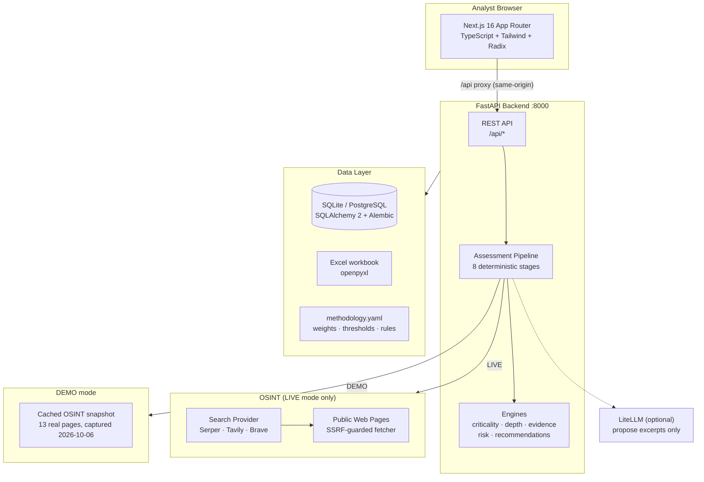
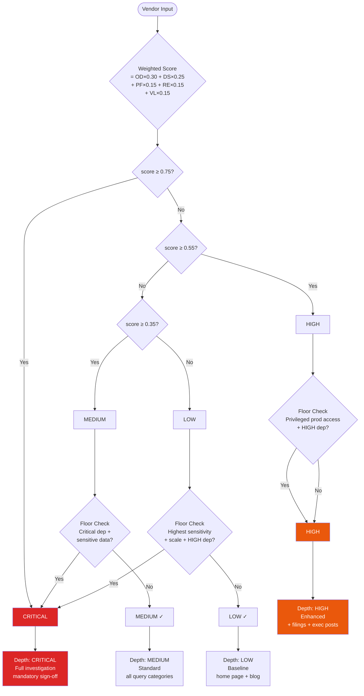
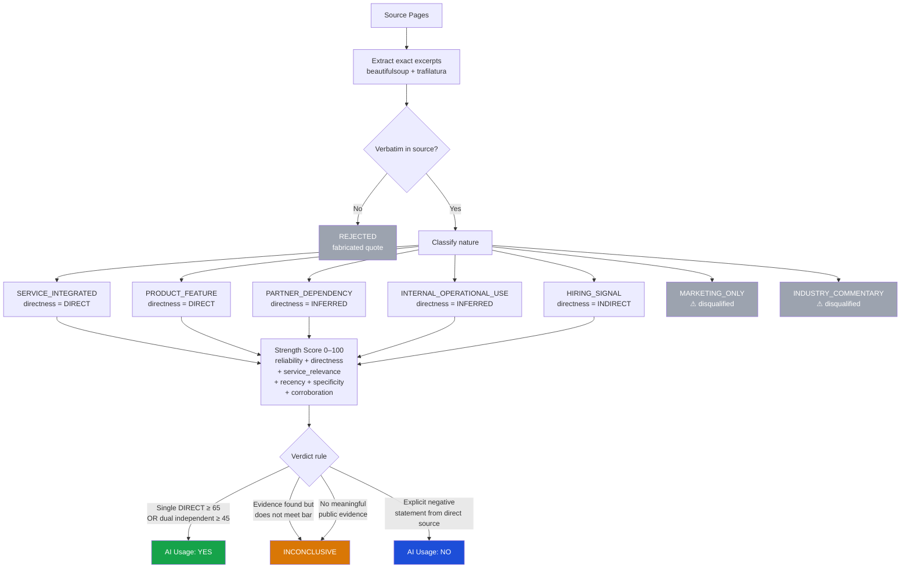
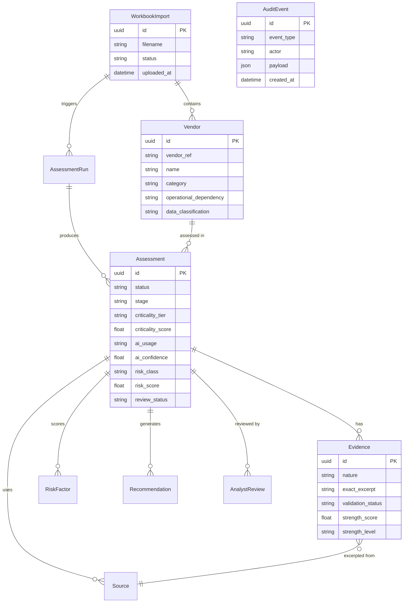

# MAVIRA — Meridian AI Vendor Intelligence & Risk Assessment

<div align="center">


**A local-first, deterministic AI Vendor Risk Assessment platform.**  
Upload a vendor inventory, get evidence-grounded AI-usage verdicts, risk scores, and prioritised recommendations — in minutes, without an LLM.

[Quick Start](#quick-start) · [Architecture](#architecture) · [Methodology](#methodology) · [API Reference](#api-reference) · [Configuration](#environment-variables)

</div>

---

## What is MAVIRA?

MAVIRA ingests a financial institution's vendor inventory workbook, automatically determines how deeply each vendor should be investigated based on criticality, collects OSINT evidence from public web pages, and runs a fully deterministic pipeline to answer:

> *"Does this vendor use AI in the service it provides to us — and if so, what is the security risk?"*

Every finding is grounded in an exact verbatim excerpt from a public source. No hallucination, no invented quotes. Analysts can approve, override, or trigger a reassessment, then export the completed workbook for submission.

### Key capabilities

| Capability | Implementation |
|---|---|
| 5-factor criticality scoring with escalation floors | `backend/app/services/criticality/` |
| Criticality-driven OSINT depth tiers | `backend/app/services/depth/` |
| Provider-agnostic OSINT (Serper, Tavily, Brave, cached snapshot) | `backend/app/services/osint/` |
| SSRF-safe, robots-aware fetcher with ETag caching | `backend/app/services/extraction/fetcher.py` |
| Evidence strength scoring (0–100) with 7 evidence natures | `backend/app/services/evidence/` |
| Exact-excerpt validation — fabricated quotes are rejected | `backend/app/services/evidence/validator.py` |
| Deterministic risk engine, 9 categories, unknowns labelled | `backend/app/services/risk/engine.py` |
| Rule-grounded recommendation engine (P1–P4, due-date SLA) | `backend/app/services/recommendations/engine.py` |
| Append-only analyst review + immutable audit trail | `backend/app/services/review/` |
| Excel write-back preserving original workbook styles | `backend/app/services/export/excel_writer.py` |
| All weights, thresholds, and rules in one YAML | `backend/app/config/methodology.yaml` |

---

## Architecture



---

## 8-Stage Assessment Pipeline


---

## Criticality Scoring



**Factor keys:** OD = Operational Dependency · DS = Data Sensitivity · PF = Payment-Flow Role · RE = Regulatory Exposure · VL = Volume (log-scaled)

---

## Evidence Scoring & AI Usage Verdict



---

## Data Model



---

## Quick Start

### Prerequisites

- Python 3.12+
- Node.js 20+ and npm

### One-command start (Windows)

```powershell
.\start.ps1
```

This kills any process on ports 8000/3000 and opens two terminal windows — backend and frontend.

### Manual setup

**Backend**

```bash
cd backend
python -m venv .venv
# Windows:
.\.venv\Scripts\Activate.ps1
# macOS/Linux:
source .venv/bin/activate

pip install -r requirements.txt
```

Create `backend/.env`:

```ini
DATABASE_URL=sqlite:///mavira.db
WORKER_MODE=inline
OSINT_MODE=DEMO
ASSESSOR_TEAM=Team MAVIRA
STORAGE_DIR=storage
CORS_ORIGINS=http://localhost:3000
```

```bash
uvicorn app.main:app --port 8000 --reload
```

**Frontend**

```bash
cd frontend
npm install
npm run dev
```

Open **http://localhost:3000**

### Docker Compose

```bash
cp .env.example .env
docker compose up --build
```

| Service | URL |
|---|---|
| Web UI | http://localhost:3000 |
| API docs (Swagger) | http://localhost:8000/api/docs |
| Health check | http://localhost:8000/api/health |
| DB browser (optional) | `docker compose --profile admin up adminer` → http://localhost:8081 |

---

## Using the Application

1. Open **http://localhost:3000**
2. Click **Import workbook** and upload `sample_data/Meridian_Vendor_Input.xlsx`
3. Click **Start assessment** — the 8-stage pipeline runs for each vendor
4. Explore vendor criticality, evidence, AI usage verdicts, risk scores, and recommendations
5. Approve or override as analyst, then **Export completed workbook**
6. To start fresh: click **Clear** (then **Confirm?**) in the sidebar — or call `POST /api/reset`

> **Mode badge in sidebar:** ⚡ LIVE (real Serper searches) or 🗄 DEMO (cached Oct 2026 snapshot). Switch via `OSINT_MODE` env var.

---

## Environment Variables

| Variable | Default | Notes |
|---|---|---|
| `DATABASE_URL` | `sqlite:///mavira.db` | Any SQLAlchemy URL; PostgreSQL also supported |
| `WORKER_MODE` | `inline` | `inline` (synchronous) or `rq` (background queue) |
| `OSINT_MODE` | `DEMO` | `DEMO` = cached snapshot; `LIVE` = real searches |
| `SEARCH_PROVIDER` | `none` | `serper`, `tavily`, or `brave` (LIVE mode) |
| `SERPER_API_KEY` | — | API key for google.serper.dev |
| `TAVILY_API_KEY` | — | API key for api.tavily.com |
| `BRAVE_API_KEY` | — | API key for api.search.brave.com |
| `LLM_PROVIDER` | `none` | Optional: `openai`, `anthropic`, `ollama` via LiteLLM |
| `LLM_MODEL` | — | e.g. `gpt-4o-mini`, `llama3.1` |
| `LLM_API_BASE` | — | For local Ollama: `http://localhost:11434` |
| `ASSESSOR_TEAM` | `Team MAVIRA` | Written to *Assessed By / Date* column in export |
| `STORAGE_DIR` | `storage` | Where uploaded workbooks are saved |
| `DEMO_STEP_DELAY_MS` | `150` | Pipeline pacing for demos (cosmetic only) |
| `CORS_ORIGINS` | `http://localhost:3000` | Allowed origins for the API |

---

## API Reference

All routes are prefixed `/api/`.

| Method | Path | Description |
|---|---|---|
| `GET` | `/health` | Mode, provider, LLM status, data egress profile |
| `POST` | `/imports` | Upload Excel workbook (multipart) |
| `GET` | `/imports/{id}` | Import status and vendor list |
| `POST` | `/runs` | Start assessment run for an import |
| `GET` | `/runs/{id}` | Run progress and per-vendor status |
| `GET` | `/vendors` | All vendor summaries with latest assessment |
| `GET` | `/vendors/{ref}` | Full vendor detail: evidence, risk, recommendations, reviews |
| `GET` | `/vendors/{ref}/runs/{run_id}` | Specific assessment for a vendor |
| `PUT` | `/vendors/{ref}/review` | Submit analyst review (approve/override/reassess) |
| `GET` | `/evidence` | All evidence items with filters |
| `GET` | `/methodology` | Current methodology configuration |
| `PUT` | `/methodology` | Update methodology (creates new version) |
| `GET` | `/exports/excel` | Download completed workbook |
| `GET` | `/exports/json` | Export all findings as JSON |
| `GET` | `/audit` | Append-only audit event log |
| `POST` | `/reset` | Wipe all assessment data (dev / re-run) |

Interactive docs: **http://localhost:8000/api/docs**

---

## Methodology

All weights, thresholds, depth tiers, evidence rules, and recommendation templates live in a single file: [`backend/app/config/methodology.yaml`](backend/app/config/methodology.yaml). Every save through the UI creates a new hashed version; old assessments retain the version they were run against.

### Criticality factors

| Factor | Weight | Basis |
|---|---|---|
| Operational Dependency | 30% | How severely would the business be disrupted if this vendor failed? |
| Data Sensitivity | 25% | Highest classification of data the vendor processes (PII, financial, payment rail) |
| Payment-Flow Role | 15% | Does the vendor sit on the payment processing path? |
| Regulatory Exposure | 15% | Are there direct regulatory obligations tied to this vendor? |
| Data Volume | 15% | Log-scaled record volume; larger footprint = greater blast radius |

**Why these 5 factors?** They map the three classic risk dimensions: *availability impact* (OD), *data impact* (DS + VL), and *compliance impact* (PF + RE) — with weights calibrated so a payment-rail vendor with moderately sensitive data cannot fall below CRITICAL regardless of other scores.

**Thresholds:** CRITICAL ≥ 0.75 · HIGH ≥ 0.55 · MEDIUM ≥ 0.35 · LOW < 0.35

**Escalation floors** (override the weighted score):
- Confirmed critical operational dependency + sensitive data or payment-rail role → **CRITICAL**
- Highest-sensitivity data at scale with HIGH operational dependency → **CRITICAL**
- Privileged production access + HIGH operational dependency → **HIGH** (minimum)

### Evidence strength components

| Component | Weight | What it measures |
|---|---|---|
| Source reliability | 35% | Press release > investor filing > exec post > marketing |
| Directness | 25% | SERVICE_INTEGRATED/PRODUCT_FEATURE > INFERRED > INDIRECT |
| Service relevance | 20% | Does the excerpt name the contracted service specifically? |
| Recency | 10% | Age of the source (documents decay) |
| Specificity | 5% | Named model or technology vs. generic "AI" mention |
| Corroboration | 5% | Independent second source for the same claim |

**AI Usage YES threshold:** Single DIRECT source with strength ≥ 65 **OR** two independent sources each ≥ 45.

### Risk categories

Model Transparency · Data Retention Unknowns · Training Data Use · Third-Party AI Provider Exposure · Agentic Capability Risk · Adversarial Robustness · Contractual Gap · Undisclosed Provider · Regulatory Alignment

Each category scores `base_weight × AI_presence_index`. Unknowns (retention policy, training use, undisclosed providers) are scored at maximum uncertainty and labelled `UNKNOWN / NOT PUBLICLY DISCLOSED` rather than guessed.

### Recommendation priorities

| Priority | Due | Triggered by |
|---|---|---|
| P1 | 15 days | CRITICAL vendor with confirmed AI + sensitive data |
| P2 | 30 days | HIGH vendor with confirmed or unconfirmed AI; or missing contract clauses |
| P3 | 60 days | MEDIUM vendor with AI signals; or vendor questionnaire needed |
| P4 | 90 days | All vendors: model transparency checklist, policy review |

---

## Tests

```bash
cd backend
pytest
```

79 tests covering: criticality, depth, methodology validation, evidence strength, usage determination, risk scoring, recommendations, exact-excerpt validation (incl. fabricated-quote rejection), rule classifier, provider detection, source classification, LLM schema + hallucination guards, Excel import edge cases, SSRF/upload/rate-limit controls, a worked-example calibration fixture, and a full end-to-end API test (upload → run → evidence verified against source → review/override/reassess → Excel export → JSON → audit).

Frontend type check:

```bash
cd frontend && npm run build
```

---

## Security

- **Secrets:** environment variables only; nothing secret committed to the repo; API keys never sent to the browser (server-side proxy pattern)
- **Upload validation:** extension + ZIP magic check, 10 MB cap, per-client rate limit; parsed with openpyxl (no macro execution)
- **SSRF protection:** scheme/port allowlist, blocks loopback/private/link-local/metadata/IPv4-mapped addresses, resolves DNS and validates every answer, re-validates on every redirect hop
- **Fetching:** robots.txt honoured, per-domain throttle, timeouts, bounded retries, response size cap
- **SQL:** ORM only, no raw SQL; React escapes all rendered text (no `dangerouslySetInnerHTML`)
- **Headers:** CSP, X-Frame-Options, nosniff, no-referrer; generic error bodies with reference IDs; JSON logs with secret redaction
- **Audit trail:** append-only events for imports, runs, results, reviews, methodology changes, and exports

---

## Data Egress

| Mode | What leaves the machine |
|---|---|
| DEMO, no LLM (default) | Nothing |
| LIVE | Search queries to the search provider; HTTP GET to public pages |
| LLM enabled | Public page text + vendor name/category/service description to configured model |

No customer data is ever sent: a standard vendor inventory contains only vendor descriptions.

---

## Project Structure

```
optiv-Case1/
├── backend/
│   ├── app/
│   │   ├── api/routes/          # FastAPI route handlers
│   │   ├── config/
│   │   │   └── methodology.yaml # All weights, thresholds, rules (single source of truth)
│   │   ├── demo_data/
│   │   │   └── osint_cache.json # Cached OSINT snapshot (13 real pages, 2026-10-06)
│   │   ├── models/              # SQLAlchemy ORM models
│   │   ├── schemas/             # Pydantic v2 request/response schemas
│   │   └── services/
│   │       ├── criticality/     # 5-factor scoring engine
│   │       ├── depth/           # OSINT depth tier selection
│   │       ├── evidence/        # Extraction, validation, strength scoring
│   │       ├── extraction/      # SSRF-safe fetcher, content parser
│   │       ├── osint/           # Search provider adapters
│   │       ├── recommendations/ # Rule-grounded recommendation engine
│   │       ├── risk/            # 9-category risk engine
│   │       └── review/          # Analyst review + audit trail
│   ├── alembic/                 # Database migrations
│   ├── tests/                   # 79 pytest tests
│   └── requirements.txt
├── frontend/
│   ├── app/                     # Next.js App Router pages
│   │   ├── vendors/             # Vendor register + detail views
│   │   ├── import/              # Workbook upload
│   │   ├── evidence/            # Evidence explorer
│   │   ├── methodology/         # Live methodology editor
│   │   └── audit/               # Audit trail viewer
│   ├── components/
│   │   └── shell.tsx            # App shell with LIVE/DEMO badge + Clear button
│   └── lib/
│       ├── api.ts               # Typed API client
│       └── hooks.ts             # SWR-style data fetching
├── docs/
│   ├── FUNCTIONAL_DESIGN.md     # Requirements and design decisions
│   ├── TECHNICAL_ARCHITECTURE.md
│   ├── SOURCE_STRATEGY.md       # Evidence collection rationale
│   └── DEMO_SCRIPT.md           # Walkthrough script
├── sample_data/
│   └── Meridian_Vendor_Input.xlsx   # Blank workbook template
├── start.ps1                    # One-command launcher (Windows)
├── docker-compose.yml
└── .env.example
```

---

## Tech Stack

**Backend:** Python 3.12 · FastAPI 0.115 · Pydantic v2 · SQLAlchemy 2 · Alembic · SQLite / PostgreSQL 16 · httpx · trafilatura · BeautifulSoup4 · openpyxl · PyYAML · LiteLLM (optional)

**Frontend:** Next.js 16 (App Router) · React 19 · TypeScript 5 · Tailwind CSS 4 · Radix UI primitives · Recharts · Lucide icons

**Infra:** Docker Compose · Redis + RQ (queue mode) · Nginx (optional)

---

## Contributing

1. Fork the repo and create a feature branch
2. Run the test suite: `cd backend && pytest`
3. Type-check the frontend: `cd frontend && npm run build`
4. Open a pull request — all methodology changes should include an update to `methodology.yaml` and corresponding tests

---

## License

MIT — see [LICENSE](LICENSE)

---

<div align="center">
Built as a demonstration of evidence-grounded, deterministic AI risk assessment for financial services vendor management.
</div>
