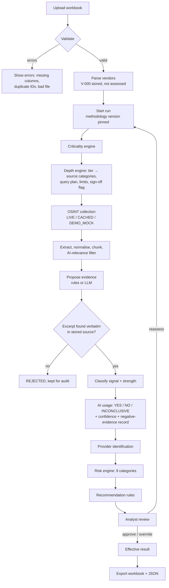

# MAVIRA — Functional Design

## 1. Objective

Give Meridian's third-party risk team a repeatable, evidence-backed answer, per vendor, to four questions:

1. How critical is this vendor to Meridian?
2. Given that, how deeply should we look for AI use?
3. Does the vendor genuinely use AI in the service it provides — and which model providers are involved?
4. What AI security risk does that create for Meridian, and what should we do next?

Every answer must be traceable to the inventory row or to a verbatim public excerpt, reproducible from a
stored methodology version, and transferable into the supplied Excel structure.

## 2. User roles

| Role | Does |
|---|---|
| TPRM analyst | Imports the inventory, runs assessments, inspects evidence, approves / overrides / requests reassessment, exports |
| Risk methodology owner | Adjusts weights, thresholds, tiers and rules as a new methodology version |
| Reviewer / stakeholder | Reads the register, vendor pages and exported workbook; audits decisions |

The deployment is single-team and local; an optional shared API key protects the API.

## 3. Input

`Meridian_Vendor_Input.xlsx`, sheet *Vendor Inventory*:

- Provided (B–K): Vendor ID, Name, Description, Service / Product Provided, Category, Public Website,
  Business Process Supported, Operational Dependency, Data Classification Accessed, Data Volume (annual).
- To complete (L–V): Criticality Tier, Criticality Rationale, Assessment Depth Applied, AI Usage Detected,
  Evidence Description + OSINT link, How Vendor May Be Using AI, Named AI Sub-processors / Model Providers,
  AI Security Risk Classification, Risk Rationale, Recommended Action, Assessed By / Date.
- V-000 is a fictional worked example and must not be edited. Vendors must not be added or removed.

## 4. Processing (overview)

## 5. Output

- Vendor register (dashboard) with criticality, AI usage + confidence, risk, evidence strength, review status.
- Vendor page: decision chain, factor breakdown, depth applied, AI usage narrative and basis, providers, risk
  breakdown, recommendations, sources checked, searches executed, review history.
- Evidence explorer across vendors.
- Completed workbook (original + Evidence Log, Sources Checked, Methodology sheets) and JSON export.
- Audit trail.

## 6. Criticality workflow

1. Map *Operational Dependency* to a score (Total/Critical 1.0, High 0.75, Moderate 0.5, Low 0.25; unknown
   values get 0.5 and are flagged "analyst to confirm").
2. Score *Data Classification* against ordered sensitivity rules (special-category data, tax identifiers,
   full customer financial records = 1.0 … no customer data = 0.2). The matched phrase is quoted.
3. Score payment-flow role from Category / Business Process / Service (payment rail 1.0, core processing 0.9).
4. Score regulatory exposure (tax/regulatory reporting and core banking records 1.0, payment systems 0.9 …).
5. Score volume: the largest record count in *Data Volume* or in a population named in *Data Classification*,
   log-scaled between 1,000 and 100 million; "entire customer base" = 1.0.
6. Weighted sum → tier by threshold; then apply escalation floors (each recorded with the rule id).
7. Rationale lists every factor with value × weight and its basis, so another analyst reaches the same tier
   from the same row.

## 7. Assessment-depth workflow

The tier selects a configured depth profile (see Source Strategy §4): source categories, query templates,
maximum sources, minimum independent sources, whether provider/sub-processor searches and a negative-evidence
review run, and whether analyst sign-off is mandatory. Depth never depends on how much a vendor publishes.

## 8. OSINT workflow

For each planned query: call the configured provider → record a `search_run` (query, category, provider,
status, result count, latency, error) → for each hit up to the tier limit: reuse a fresh cached source by URL
hash or fetch it (LIVE) / take its snapshot text (CACHED) → classify source type and reliability → skip
duplicate content → link it to the assessment. Failed searches or fetches are recorded and the vendor continues.

## 9. Evidence workflow

1. Chunk each source; keep only chunks containing AI terms.
2. Propose evidence sentence-by-sentence (headings skipped; very short sentences joined with the next).
3. Validate each proposal: the excerpt must occur in the stored text after normalising whitespace, quotes and
   zero-width characters. Offsets are stored so the UI highlights the exact span in the source.
4. Rejected proposals are stored with the reason and never used.
5. Each valid excerpt gets a signal type, AI types, service relevance, directness, a 0–100 strength with a
   factor breakdown, and a separate classification confidence.

The UI always shows **source fact** (serif, highlighted, verbatim) apart from **system interpretation**.

## 10. AI classification workflow

Signal types: SERVICE_INTEGRATED, PRODUCT_FEATURE, INTERNAL_OPERATIONAL_USE, PARTNER_DEPENDENCY,
HIRING_SIGNAL, MARKETING_ONLY, INDUSTRY_COMMENTARY (extension: statements about AI in general or advocacy, not
the vendor's own use), UNKNOWN.

Determination:
- **YES** — a confirming signal (SERVICE_INTEGRATED or PRODUCT_FEATURE) with strength ≥ 65, or two confirming
  signals from distinct sources with strength ≥ 45.
- **NO** — only an explicit negative statement from a direct vendor source, with no contrary signal.
- **INCONCLUSIVE** — everything else, with either the list of non-confirming signal types or the statement
  "NO MEANINGFUL PUBLIC EVIDENCE IDENTIFIED WITHIN ASSESSED OSINT SCOPE" plus sources checked / searches run.

If confirmation is vendor-level only (no excerpt names the contracted service), the basis says so.

## 11. Risk workflow

Inputs: criticality factors, AI usage, AI exposure (max of signal weight × strength), AI types, signal types,
provider status. Nine categories (data exposure, sub-processor, provider transparency, retention, training,
decision impact, operational dependency, regulatory, contractual) each = base × AI presence. Weighted sum →
class. Floors and the vendor-level discount are applied and recorded. No AI signal → *None identified*, with
an explicit statement that this reflects public evidence, not confirmed absence.

## 12. Analyst review

- **Approve** — records analyst and optional comment.
- **Override** — requires analyst and a reason (≥ 10 characters); may change criticality tier, AI usage, risk
  class (and narrative fields via API). The generated values stay untouched; the override is a new review row
  with an original snapshot. The *effective* result (used in register and export) applies the latest override.
- **Request reassessment** — requires a reason; creates a new run for that vendor linked to the parent run.
  History is never overwritten.

Critical-tier vendors and any High/Critical risk result are flagged "sign-off required".

## 13. Export

Writes the eleven assessment columns for assessed vendors into the uploaded workbook, preserving everything
else, and appends Evidence Log, Sources Checked and Methodology sheets. *Assessed By / Date* shows the team,
completion date and reviewer (or "pending analyst review"). JSON export carries the full detail.
