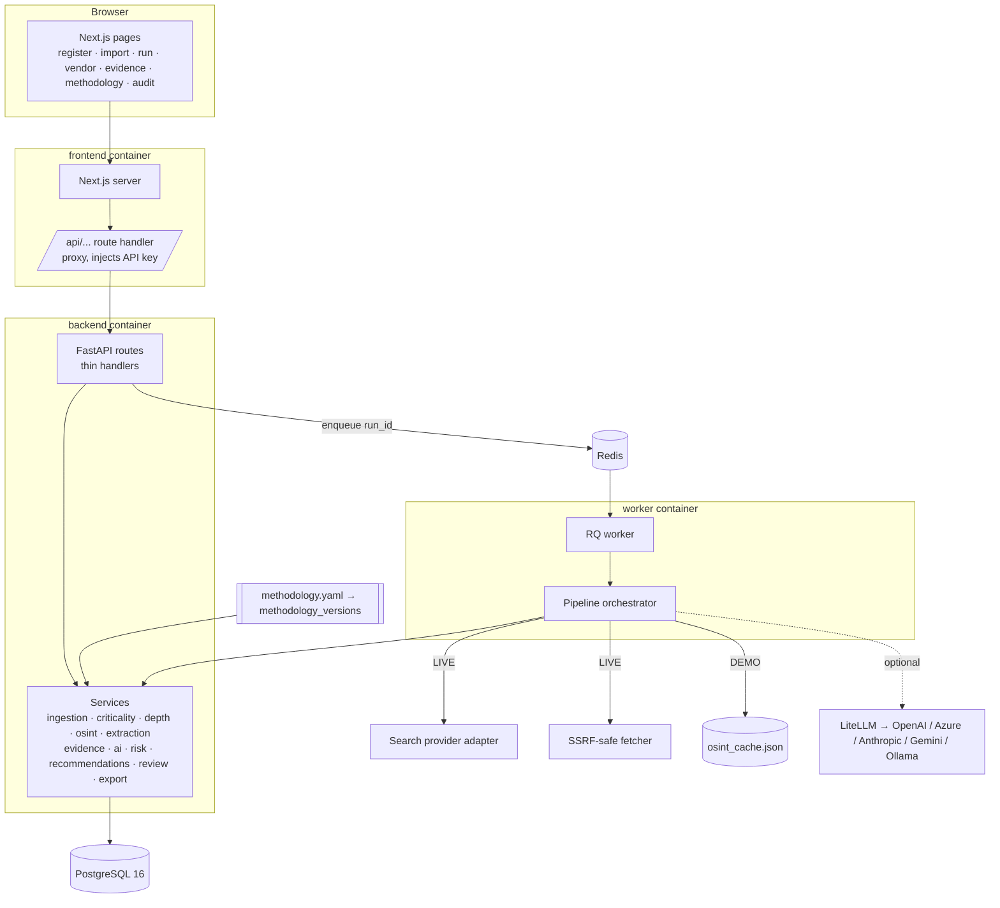
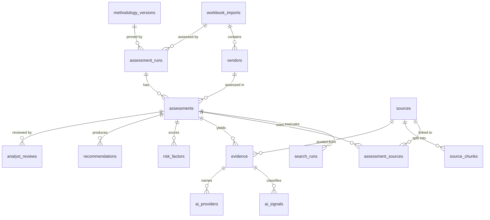

# MAVIRA — Technical Architecture

## 1. Shape

Modular monolith plus background worker, run by Docker Compose. No microservices, message bus or cloud
dependencies. Everything can run offline (DEMO mode, rule-based analyzer).

## 2. Components

### Frontend (`frontend/`)
Next.js 16 App Router, React 19, TypeScript, Tailwind 4, shadcn/ui-style components on Radix (tabs, dialog,
slot), Recharts. All data calls go to the same-origin `/api/*` route handler, which forwards to `BACKEND_URL`
and adds `X-API-Key` server-side, so the browser never sees backend location or secrets. Pages are client
components that poll (run progress every 0.8 s until final). Security headers incl. CSP are set in
`next.config.mjs`. Fonts are self-hosted via `@fontsource` (no third-party font requests).

### API (`backend/app/api/routes/core.py`)
FastAPI with Pydantic request models. Handlers validate and delegate; business logic lives in services.
Endpoints: `health, imports (POST/GET), runs (POST/GET), dashboard, assessments/{id}, vendors/{id}/history,
evidence, sources/{id}, assessments/{id}/reviews, methodology (GET/PUT), exports/excel, exports/json, audit`.
OpenAPI at `/api/docs`. Global handlers return safe error bodies; unhandled errors log a reference id.

### Authentication
Optional shared key (`API_KEY`) checked with constant-time comparison. Analyst identity is captured per
action (`X-Analyst` header / review payload) and written to the audit trail. SSO is out of scope for the
local deployment; put the stack behind the organisation's identity proxy for shared use.

### Database
PostgreSQL 16, SQLAlchemy 2 ORM, Alembic migrations. Key relationships:

Constraints: `sources.url_hash` unique (global source cache), `(run_id, vendor_id)` unique, `(import_id,
vendor_ref)` unique, `methodology_versions.content_hash` unique. Indexes on all FKs and on status/tier
columns used by the register. JSON columns hold factor breakdowns, depth plans, stage logs and rule grounding.

### Queue and workers
`WORKER_MODE=rq`: the API enqueues `run_assessment(run_id)` on the `assessments` queue; the worker executes
it. `WORKER_MODE=inline`: a daemon thread in the API process (single-process development). If Redis enqueue
fails, the API falls back to inline so a run is never lost.

### Pipeline orchestrator (`services/pipeline/orchestrator.py`)
Per vendor, twelve persisted stages (profile → criticality → depth → strategy → sources → extraction →
proposals → validation → AI usage → providers → risk → recommendations). Each stage commits and appends to
`stage_log`, which drives the live progress view. Exceptions inside a source or search are recorded on the
assessment and processing continues (status PARTIAL); an exception that escapes a vendor marks that vendor
FAILED and the run continues.

### OSINT layer (`services/osint/`)
`SearchProvider` interface with `TavilyProvider`, `SerperProvider`, `BraveProvider` (retry with backoff on
429/5xx), `CachedSnapshotProvider` (DEMO) and `FixtureProvider` (tests, DEMO_MOCK). `get_provider()` selects
by environment. `source_classifier` assigns source type and reliability from ordered methodology rules using
whole-token path matching and registrable-domain comparison (incl. declared alias domains such as
`investors.fiserv.com`).

### Extraction (`services/extraction/`)
`Fetcher`: SSRF validation on the URL and every redirect hop, robots.txt (cached per host), per-domain
minimum interval, timeouts, bounded retries, conditional GET with ETag/Last-Modified, 3 MB cap, HTML only.
Text via trafilatura with BeautifulSoup fallback. `text.py`: display-safe cleaning, canonical normalisation
for matching, URL and content hashing, offset-preserving chunking, sentence splitting.

### LLM layer (`services/ai/llm_analyzer.py`)
LiteLLM, provider chosen by `LLM_PROVIDER` / `LLM_MODEL` / `LLM_API_BASE`, temperature 0, JSON response
format, prompt version `mavira-evidence-v1`. Output → `LLMEvidenceResponse` (Pydantic) → provider-name guard
→ deterministic service-relevance recomputation and SERVICE_INTEGRATED guard → exact-excerpt validator.
Any failure falls back to the rule analyzer for that source. The LLM never touches scores.

### Evidence engine (`services/evidence/`)
`validator.py`: normalise both strings with an index map, `find`, map offsets back to the original text.
`strength.py`: reliability, directness, specificity, service relevance, independence (corroboration of the
same AI type on another domain), recency → 0–100 with breakdown and level.

### Criticality engine (`services/criticality/engine.py`)
Pure function of the inventory row and methodology. Returns score, weighted tier, final tier, factor objects
(score, weight, contribution, basis, matched rule), escalations, rationale and methodology label.

### Risk engine (`services/risk/engine.py`)
Pure function of `RiskInputs` and methodology. Returns score, class, AI presence, nine category scores with
status (`ASSESSED` / `UNKNOWN / NOT PUBLICLY DISCLOSED` / `NOT_APPLICABLE`), floors and rationale.

### Recommendation engine (`services/recommendations/engine.py`)
Ordered YAML rules with typed conditions (unknown conditions raise). Each emitted recommendation stores its
conditions, matched evidence ids and the facts it saw.

### Export engine (`services/export/`)
`serializers.py` is the single source of API/export payloads. `excel_writer.py` reopens the stored upload,
writes assessment columns by mapped column index, never touches V-000 or provided columns, and appends the
three evidence/methodology sheets. JSON export serialises full assessment detail.

## 3. Reproducibility and audit

Each run stores: methodology version id and label (version + content hash), OSINT mode, search provider,
analyzer name/version, model name, prompt version, trigger actor, parent run. Each source stores retrieval
time, content hash, ETag/Last-Modified and collection method. Each evidence row stores who proposed it and
its validation result. Reviews store the original snapshot. `audit_events` records IMPORT_ACCEPTED /
REJECTED, RUN_CREATED / STARTED / COMPLETED, VENDOR_ASSESSED / FAILED, REVIEW_*, METHODOLOGY_ACTIVATED and
EXPORT_*. Changing `methodology.yaml` on disk registers a new version at startup; editing in the UI creates
one too; earlier assessments keep the version they were scored with.

## 4. Observability

JSON logs on stdout with `assessment_run_id` (context variable), vendor, stage, status, source, latency,
retry and model fields; secrets are redacted by pattern. Page content is not logged.

## 5. Security controls

See README §Security. Summary: env-only secrets, server-side API proxy, upload validation and rate limiting,
SSRF guard with DNS and redirect checks, robots/throttle/timeouts, ORM-only SQL, React escaping + CSP,
security headers, non-root containers, localhost-bound ports, append-only audit.

## 6. Deployment

`docker compose up --build` starts postgres (healthchecked), redis, backend (runs `alembic upgrade head`
then uvicorn), worker (RQ), frontend (Next standalone). `--profile admin` adds Adminer. Volumes: `pgdata`
and `storage` (uploaded workbooks, keyed by SHA-256).
